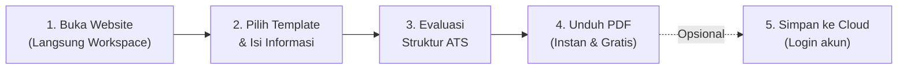
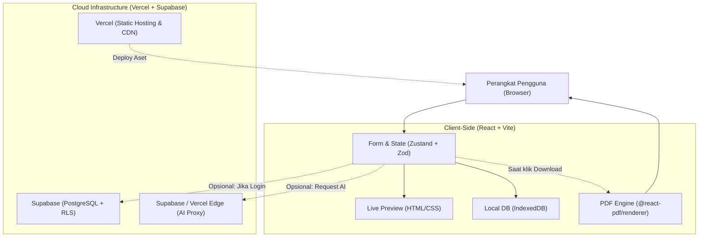

# 🚀 Blueprint Implementasi: Free ATS Resume Builder

> **Konsep Utama: Tool-First Web Application**  
> Bangun aplikasi seperti filosofi **iLovePDF**: pengguna langsung masuk ke workspace editor tanpa hambatan (*zero login wall*), langsung mengedit CV, melihat *live preview*, dan mengunduh PDF ATS-friendly secara instan dan 100% gratis.

---

## 📑 Daftar Isi
1. [Prinsip Produk & Alur Pengguna](#1-prinsip-produk--alur-pengguna)
2. [Roadmap Fitur & Prioritas Rilis](#2-roadmap-fitur--prioritas-rilis)
3. [Arsitektur UI/UX & Desain Layout](#3-arsitektur-uiux--desain-layout)
4. [Tech Stack & Keputusan Arsitektur](#4-tech-stack--keputusan-arsitektur)
5. [Strategi Performa & Optimasi Editor](#5-strategi-performa--optimasi-editor)
6. [Tahapan Implementasi (Step-by-Step)](#6-tahapan-implementasi)
7. [Rencana Pengujian & Quality Assurance](#7-rencana-pengujian--quality-assurance)
8. [Ringkasan Keputusan Teknis](#8-ringkasan-keputusan-teknis)

---

## 1. Prinsip Produk & Alur Pengguna

Aplikasi ini dirancang sebagai **alat kerja instan**, bukan SaaS korporat yang rumit. Hindari *landing page* promosi yang memaksa registrasi sebelum mencoba produk.

### 🔄 Alur Kerja Pengguna (5 Langkah)



1. **Buka Website**  
   Pengguna langsung disuguhkan kanvas CV editor. Dokumen baru dibuat otomatis di penyimpanan lokal perangkat.
2. **Pilih Template & Isi Data**  
   Mulai dari CV kosong atau template ATS standar. Panel formulir dan pratinjau (*live preview*) berjalan berdampingan dalam satu layar.
3. **Periksa Struktur CV (ATS Checker)**  
   Sistem mengecek kelengkapan bagian penting, format tanggal, konsistensi penulisan, serta kepadatan kata kunci.
4. **Unduh PDF Instan**  
   Mengunduh dokumen PDF berbasis teks (*parsable text*) tanpa watermark, biaya tersembunyi, atau kewajiban membuat akun.
5. **Simpan ke Cloud (Opsional)**  
   Registrasi/login hanya diminta jika pengguna ingin menyimpan banyak versi CV, sinkronisasi lintas perangkat, atau menggunakan fitur berbasis akun.

> [!IMPORTANT]
> **Prinsip Utama (Offline/Local-First):**  
> Seluruh alur pembuatan dan pengunduhan CV dasar **wajib berfungsi normal** meski pengguna offline, belum login, atau server database sedang *down*.

---

## 2. Roadmap Fitur & Prioritas Rilis

Pengembangan dibagi ke dalam 3 tier agar fokus pada nilai guna nyata (*usable MVP*) terlebih dahulu.

### 🟢 Tahap 1: MVP (Minimum Viable Product)
Fokus: Editor yang stabil, cepat, dan menghasilkan PDF berkualitas tinggi.

| Modul Fitur | Detail Implementasi |
| :--- | :--- |
| **Instant CV Builder** | Workspace langsung aktif begitu URL dibuka tanpa *loading barrier*. |
| **Template Library** | 4–6 template ATS-friendly (1 kolom, tipografi bersih, hirarki heading jelas). |
| **Live Preview** | Pratinjau dokumen A4 reaktif dan tersinkronisasi *real-time* dengan input form. |
| **Personal Info** | Nama, kontak (email, telepon, domisili), dan link profil (LinkedIn, GitHub, Portfolio). |
| **Resume Sections** | Summary, Experience, Education, Skills, Projects, Certifications, Languages, Awards, Volunteering. |
| **Section Management**| Tambah, sembunyikan, hapus, dan atur ulang urutan (*reorder*) section. |
| **Experience Editor** | Multi-entri pekerjaan, penataan tanggal, toggle *Currently Working Here*, dan bullet-points generator. |
| **Page Management** | Format standar A4, kalkulasi batas halaman (*page-break*), margin proporsional. |
| **Auto-Save Lokal** | Penyimpanan instan ke browser (**IndexedDB**) tanpa ketergantungan server. |
| **Client-side PDF** | Ekspor PDF berbasis teks asli (bukan gambar/screenshot), teks dapat diseleksi dan di-copy. |
| **Basic ATS Checker** | Validasi aturan heuristik (kehadiran email, nomor telepon, heading baku, panjang bullet). |
| **Responsive UI** | Tampilan adaptif untuk desktop, tablet, dan smartphone. |

> [!WARNING]
> **Pedoman Template ATS:**
> - Prioritaskan layout **satu kolom**, heading baku (`Experience`, `Education`), dan kontras warna yang solid.
> - Hindari penggunaan *skill progress bars*, grafik bintang rating, tabel bersarang, atau ikon SVG dekoratif di area teks utama yang dapat membingungkan parser ATS lama.
> - **Etika ATS Checker:** Jangan menjanjikan "100% lolos ATS" karena setiap vendor ATS (Workday, Greenhouse, Taleo) memiliki algoritma parsing yang unik. Posisikan checker sebagai asisten validasi struktur & keterbacaan.

---

### 🟡 Tahap 2: Cloud Sync & Produktivitas
*Diimplementasikan setelah alur pembuatan & download PDF lokal terbukti 100% stabil.*

- **Autentikasi Fleksibel:** Login sosial (Google, GitHub) atau email magic link.
- **Multi-Resume Dashboard:** Kelola, kelompokkan, dan ganti nama beberapa versi CV.
- **Duplicate Resume:** Duplikasi draft dalam satu klik untuk menyesuaikan CV dengan lowongan spesifik.
- **Riwayat & Undo/Redo:** Dukungan riwayat perubahan (*history revision*) dan restore draft.
- **Ekspor DOCX:** Format Microsoft Word sebagai alternatif bagi rekruter yang mensyaratkan `.docx`.
- **Parser Dokumen (Import):** Impor data dari CV lama (PDF/DOCX) ke dalam formulir editor.
- **Bilingual Interface:** Pilihan bahasa antarmuka (Bahasa Indonesia & Bahasa Inggris).

---

### 🟣 Tahap 3: AI Resume Assistant (Ekstensi Cerdas)
*Fitur AI bersifat add-on bernilai tambah, bukan prasyarat operasi editor.*

| Fitur AI | Peran & Batasan |
| :--- | :--- |
| **AI Bullet Enhancer** | Mengubah draf kalimat kasar menjadi format aksi-dampak (misal: *Action Verb + Context + Result*). |
| **Summary Generator** | Merangkum profil profesional otomatis berdasarkan riwayat kerja dan keahlian yang diisi. |
| **Job Description Matcher**| Menganalisis teks lowongan kerja dan memberikan rekomendasi kata kunci (*keywords gap*). |
| **AI Grammatical Polish** | Memperbaiki struktur bahasa tanpa mengubah fakta atau menambahkan data fiktif (*no hallucinations*). |
| **Cover Letter Generator** | Menghasilkan draf surat lamaran relevan yang mengacu pada CV dan deskripsi lowongan. |

> [!TIP]
> **Kebijakan Penggunaan AI:**  
> 1. AI hanya dipanggil melalui aksi eksplisit pengguna (misal klik tombol *"Tingkatkan dengan AI"*), bukan panggilan otomatis per karakter ketikan.  
> 2. Terapkan kuota harian/akun untuk menjaga biaya operasional server tetap efisien. Fitur editor inti tetap gratis tanpa batas.

---

## 3. Arsitektur UI/UX & Desain Layout

### A. Desktop Workspace: 3-Panel Layout
Pada layar monitor / laptop, antarmuka dibagi menjadi 3 kolom kerja yang terintegrasi:

```
+---------------------------------------------------------------------------------------+
|  [Logo] ATS Resume Studio     Untitled CV [Saved]     [Template v]    [ Download PDF ]|
+-------------------+-----------------------------------+-------------------------------+
| SECTIONS          | EDIT SECTION: Experience          | LIVE PREVIEW (A4)             |
|                   |                                   |                               |
| [v] Profile       | Job Title                         | +---------------------------+ |
| [v] Summary       | [ Software Engineer             ] | | Alex Morgan               | |
| [*] Experience    |                                   | | alex@mail.com | Jakarta   | |
| [ ] Education     | Company                           | |                           | |
| [ ] Skills        | [ Tech Nusantara Corp           ] | | PROFESSIONAL SUMMARY      | |
| [ ] Projects      |                                   | | Experienced dev with...   | |
|                   | Bullet Points                     | |                           | |
|                   | * Built microservices...          | | EXPERIENCE                | |
|                   | * Optimized SQL queries...        | | Tech Nusantara Corp       | |
|                   |                                   | | * Built microservices...  | |
|                   | [ + Add Bullet ]  [ Save Entry ]  | +---------------------------+ |
| + Add Section     |                                   | [Zoom 100%] [Page 1 of 1]    |
+-------------------+-----------------------------------+-------------------------------+
```

1. **Top Navigation Toolbar:**  
   Branding, penamaan judul CV, indikator status penyimpanan (*Saved / Syncing / Offline*), selektor template, dan tombol CTA utama: **Download PDF**.
2. **Left Panel (Sidebar Navigasi Bagian):**  
   Daftar section dokumen dengan indikator progres kelengkapan. Memungkinkan perpindahan cepat antar-bagian tanpa *scrolling* panjang.
3. **Center Panel (Formulir Dinamis):**  
   Formulir input aktif untuk section yang dipilih. Dilengkapi kontrol multi-entri (tambah, edit, hapus, drag-to-reorder).
4. **Right Panel (Interactive Live Preview):**  
   Representasi visual dokumen A4 asli. Perubahan data di form tengah langsung terproyeksikan secara *instant* di panel ini.

---

### B. Mobile Layout: Tabbed Experience
Pada perangkat berlayar sempit, layout otomatis bertransformasi menjadi 1 kolom dengan sistem navigasi tab:

```
+-----------------------------------+
| [Logo] Resume Studio      [⚙ Menu]|
+-----------------------------------+
|  [  ✏️ Form Editor  ] [  👁️ Preview ]  |
+-----------------------------------+
| Section: Personal Details         |
|                                   |
| Full Name                         |
| [ Alex Morgan                   ] |
|                                   |
| Email Address                     |
| [ alex@mail.com                 ] |
|                                   |
| [ Next Section: Experience -> ]   |
|                                   |
+-----------------------------------+
| [Sticky Bar:  📥 Download PDF   ] |
+-----------------------------------+
```

- **Dual-Tab Mode:** Pilihan tab cepat antara mode pengisian formulir (**Form Editor**) dan pratinjau dokumen (**Preview**).
- **Sticky Bottom Action Bar:** Tombol unduh PDF dan navigasi section tetap mudah dijangkau satu jempol.
- **Kontrol Up/Down:** Tombol panah atas/bawah disediakan sebagai alternatif *drag-and-drop* pada layar sentuh.

---

### C. Struktur Halaman Homepage (SEO & Discovery)
Konten marketing diletakkan di **bawah workspace** agar tidak menghalangi pengguna langsung berkreasi:

1. **Section 1 (First Viewport):** Interactive Resume Workspace (Prioritas #1).
2. **Section 2:** Template Gallery & Live Showcase.
3. **Section 3:** Panduan Standar Format CV ATS (Edukasi & SEO Keywords).
4. **Section 4:** Tutorial Singkat: 3 Langkah Membuat CV.
5. **Section 5:** FAQ (Privasi data, kompatibilitas ATS, lisensi ekspor).
6. **Section 6:** Footer & Kebijakan Privasi.

---

## 4. Tech Stack & Keputusan Arsitektur

Arsitektur yang direkomendasikan adalah **Frontend-First (Client-Centric)**.



### Tabel Komponen Teknologi

| Layer | Solusi Terpilih | Justifikasi Teknis |
| :--- | :--- | :--- |
| **Frontend Framework** | **React + TypeScript + Vite** | Ringan, kompilasi super cepat, ideal untuk *heavy-client interactive state*, tanpa overhead SSR yang tidak diperlukan pada editor. |
| **Styling** | **Tailwind CSS v4** | Performa CSS *engine* berbasis Rust yang sangat kencang, konsistensi token desain dan tipografi. |
| **UI Primitives** | **shadcn/ui + Lucide Icons** | Komponen aksesibel, mudah dimodifikasi, tanpa dependensi vendor yang kaku. |
| **State Management** | **Zustand** | Manajemen state granular dengan *selector subscriptions* untuk mencegah *unnecessary re-renders*. |
| **Form Handling** | **React Hook Form + Zod** | Validasi skema ketat (*type-safe*), penanganan *dirty state*, dan efisiensi memori form. |
| **Drag & Drop** | **@dnd-kit** | Library reorder paling modular dan ramah aksesibilitas (*mobile touch friendly*). |
| **Local Persistence** | **IndexedDB (via idb-keyval)** | Kapasitas penyimpanan besar (jauh melampaui limit 5MB LocalStorage), asynchronous, tidak memblokir UI thread. |
| **PDF Generation** | **@react-pdf/renderer** | Menghasilkan PDF berbasis teks murni di sisi browser tanpa beban komputasi di server. |
| **Database & Auth** | **Supabase (PostgreSQL)** | Manajemen autentikasi instan, skema JSONB fleksibel, serta proteksi *Row Level Security* (RLS). |
| **Hosting & Deploy** | **Vercel** | CDN global terdistribusi, integrasi Git otomatis, *preview branches*. |
| **AI Processing** | **Supabase Edge Functions** | Panggilan LLM aman dari serverless functions tanpa mengekspos API Key ke browser. |

---

### 💡 Mengapa React + Vite, Bukan Next.js?
1. **Karakteristik Aplikasi:** Editor CV adalah aplikasi *client-heavy canvas*. Sebagian besar operasi (mengetik, memformat, memvalidasi, preview, ekspor PDF) berjalan di dalam memori browser pengguna.
2. **Kemandirian Infrastruktur:** Dengan Vite, seluruh frontend dapat di-bundle menjadi aset statis murni yang dapat disajikan secara instan via CDN dengan *zero server cost*.
3. **Kecepatan & Sederhana:** Menghindari kompleksitas *Server Actions, Hydration mismatch, server context,* dan konfigurasi *bundler* PDF yang sering kali bermasalah di Next.js App Router.
4. *Catatan Transisi:* Jika nantinya platform berkembang membutuhkan ratusan halaman artikel blog/SEO dinamis, Next.js dapat dipertimbangkan atau landing page bisa dipisah ke subdomain.

---

### Skema Database Sederhana (Supabase PostgreSQL)

```sql
-- Tabel Profil Pengguna
create table profiles (
  id uuid references auth.users on delete cascade primary key,
  full_name text,
  avatar_url text,
  updated_at timestamp with time zone default timezone('utc'::text, now())
);

-- Tabel Resume (JSONB Pattern)
create table resumes (
  id uuid default gen_random_uuid() primary key,
  user_id uuid references auth.users on delete cascade not null,
  title text default 'Untitled Resume',
  template_id text default 'classic-ats',
  schema_version integer default 1,
  content jsonb not null default '{}'::jsonb,
  is_favorite boolean default false,
  created_at timestamp with time zone default timezone('utc'::text, now()),
  updated_at timestamp with time zone default timezone('utc'::text, now())
);

-- Aktifkan Row Level Security
alter table resumes enable row level security;
create policy "Users can only access their own resumes"
  on resumes for all
  using (auth.uid() = user_id);
```

> [!NOTE]
> Pilih region database **Southeast Asia (Singapore - `ap-southeast-1`)** di konsol Supabase untuk latensi paling rendah bagi pengguna di Indonesia.

---

## 5. Strategi Performa & Optimasi Editor

Aplikasi editor rentan melambat (*laggy*) jika setiap ketukan tombol memicu komputasi berat. Berikut panduan mitigasinya:

### A. Pembagian Beban Kerja: Browser vs Server

| Komputasi Sisi Klien (Browser) | Komputasi Sisi Server (Supabase/Edge) |
| :--- | :--- |
| ✅ Mengetik & sanitasi teks formulir | ☁️ Autentikasi akun & session tokens |
| ✅ Kalkulasi live preview dokumen | ☁️ Sinkronisasi multi-device & cloud backup |
| ✅ Pergantian tema template & font styling | ☁️ Eksekusi API AI (LLM Bullet point & matching) |
| ✅ Evaluasi aturan heuristik ATS | ☁️ Pengawasan kuota & rate-limiting API |
| ✅ Rendering & pengunduhan berkas PDF | |

### B. Mekanisme Autosave yang Efisien
- **State Primer:** React State & IndexedDB disimpan secara synchronous / microtask setiap kali input berubah.
- **Cloud Sync:** Jika pengguna telah login, data dikirim ke Supabase dengan teknik **Debounce 800–1000 ms** setelah ketukan terakhir.
- **Status Indicator:**
  - `Tersimpan (Lokal)`: Saat bekerja offline / tanpa login.
  - `Menyimpan...`: Saat proses sync cloud berlangsung.
  - `Tersimpan di Cloud`: Sinkronisasi berhasil.
  - `Offline Mode`: Gagal menghubungi server, data lokal tetap aman.

### C. Mencegah Re-render Berlebih pada Live Preview
1. **Zustand Selectors:** Komponen hanya mengamati potongan state miliknya (misal: `<EducationSection />` hanya me-re-render jika data `education` berubah).
2. **Dual-Rendering Architecture:**
   - **Pratinjau Layar:** Menggunakan elemen HTML/CSS murni berbobot ringan untuk menjamin 60 FPS saat mengetik.
   - **Ekspor PDF:** Menggunakan `@react-pdf/renderer` yang **hanya diimpor secara dinamis (*lazy loaded / dynamic import*)** saat tombol *Download PDF* diklik.

### D. Target Core Web Vitals

```
+-----------------------------------------------------------------+
| Metric                   | Target Ideal    | Strategi Kunci     |
+--------------------------+-----------------+--------------------+
| LCP (Largest Contentful) | <= 2.5 Detik    | Local WOFF2 Fonts  |
| INP (Interaction Next)   | <= 200 ms       | Debounced state    |
| CLS (Cumulative Shift)   | <= 0.1          | Fixed canvas ratio |
+-----------------------------------------------------------------+
```

---

## 6. Tahapan Implementasi

Pelaksanaan proyek dibagi menjadi fase modular terukur:

```mermaid
gantt
    title Roadmap Pengerjaan ATS Builder
    dateFormat  X
    axisFormat %d
    section Rancang Bangun
    Tahap 0: Validasi Fondasi Teknis     :active, t0, 0, 3
    Tahap 1: Core MVP Editor             :t1, after t0, 5
    Tahap 2: Polish UI/UX & Template      :t2, after t1, 4
    Tahap 3: Cloud Sync & Auth           :t3, after t2, 4
    Tahap 4: ATS Heuristics Checker      :t4, after t3, 3
    Tahap 5: AI Integration & Parser     :t5, after t4, 4
```

### 📌 Rincian Tiap Tahap:

- [ ] **Tahap 0 — Validasi Fondasi Teknis (Spike)**
  - Setup repo Vite + React + TypeScript + Tailwind CSS.
  - Buat 1 form sederhana, 1 dokumen preview A4, dan tombol uji `@react-pdf/renderer`.
  - *Output:* Terbukti bisa menghasilkan PDF yang teksnya dapat di-copy dan tidak pecah.

- [ ] **Tahap 1 — Bangun Core MVP Editor**
  - Definisikan tipe TypeScript lengkap untuk skema data resume.
  - Setup Zustand store dengan persistensi ke IndexedDB.
  - Buat form untuk semua section dasar (Profile, Summary, Experience, Education, Skills).
  - *Output:* Pengguna bisa mengisi data lengkap dan data tidak hilang saat browser di-refresh.

- [ ] **Tahap 2 — Polish UI/UX & Koleksi Template**
  - Implementasi 3-panel desktop layout dan dual-tab mobile layout menggunakan shadcn/ui.
  - Hadirkan 4–6 template ATS (Classic, Modern Clean, Executive, Minimalist).
  - Tambahkan fitur reorder section (@dnd-kit) dan manajemen halaman A4.
  - *Output:* Aplikasi siap rilis ke publik sebagai *standalone free tool*.

- [ ] **Tahap 3 — Cloud Save & Autentikasi**
  - Deploy frontend ke Vercel.
  - Hubungkan Supabase Auth (Google & Email) dan setup tabel `resumes` dengan RLS.
  - Buat dashboard resume sederhana untuk pengguna yang login.
  - *Output:* Pengguna bisa memilih menyimpan CV di akun mereka atau tetap anonim.

- [ ] **Tahap 4 — ATS Checker Berbasis Aturan**
  - Analisis kelengkapan profil (deteksi jika nomor telepon/email kosong).
  - Analisis format pengalaman (cek apakah ada bullet point yang terlalu pendek atau tanpa angka).
  - Tampilkan widget penilaian & checklist perbaikan di samping editor.
  - *Output:* CV builder memberikan nilai tambah edukatif bagi pencari kerja.

- [ ] **Tahap 5 — Integrasi AI & Fitur Lanjutan**
  - Setup Supabase Edge Function untuk proxy panggilan OpenAI / Claude / Gemini API.
  - Rilis fitur *Enhance Bullet Point* dan *Keyword Matching* dari teks lowongan.
  - Terapkan sistem kuota penggunaan per akun.
  - *Output:* Monetisasi atau tier fitur cerdas yang terkontrol biayanya.

---

## 7. Rencana Pengujian & Quality Assurance

| Kategori Tes | Instrumen | Target & Skenario |
| :--- | :--- | :--- |
| **Functional Tests** | **Vitest** | Validasi skema Zod, fungsi kalkulasi tanggal, formatting teks bullet. |
| **End-to-End (E2E)** | **Playwright** | Alur lengkap: Buka web -> Isi form -> Ganti template -> Unduh PDF. |
| **Responsive QA** | **Chrome DevTools** | Uji viewport: 360px (Android), 390px (iPhone), 768px (iPad), 1440px (Laptop). |
| **PDF Extraction QA**| **pdf-parse / pdftotext** | Verifikasi bahwa teks pada file PDF hasil ekspor terbaca berurutan dan utuh. |
| **Performance QA** | **Google Lighthouse** | Skor Performance >= 90, Accessibility >= 95, SEO >= 90. |
| **Load Testing** | **k6** | Uji ketahanan Supabase Auth & Sync hingga 1.000 virtual users (VUs) di staging. |

---

## 8. Ringkasan Keputusan Teknis

```
Frontend Architecture : React 19 + TypeScript + Vite
Design & Components   : Tailwind CSS v4 + shadcn/ui + Lucide
State Management      : Zustand (Modular Store with Selectors)
Form & Validation     : React Hook Form + Zod
Local Persistence     : IndexedDB (idb-keyval)
PDF Engine            : @react-pdf/renderer (Dynamic Client-side Rendering)
Backend & Database    : Supabase (PostgreSQL + JSONB + Row Level Security)
Hosting & CI/CD       : Vercel
```

> **Kesimpulan Akhir:**  
> Arsitektur ini menempatkan pengalaman pengguna dan privasi sebagai prioritas tertinggi. Dengan memproses pembuatan dokumen langsung di perangkat pengguna, website akan terasa **instan, hemat biaya server, dan dapat diandalkan kapan saja**.